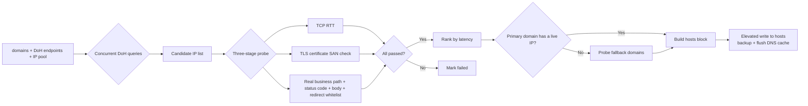

# ghprobe

English | [简体中文](README.md)

Your network, your measurements — GitHub direct-connect hosts, probed and updated locally, no proxy required.

## What it is

Reaching GitHub from mainland China is not just a DNS problem. Hostname-level SNI blacklists (e.g. `raw.githubusercontent.com` being reset precisely), and entire ranges of good resolver endpoints getting blocked, vary by region, ISP, and time of day. Any centrally published static hosts list is therefore always stale.

ghprobe moves the probing onto your own machine:

1. **DoH federation for candidates** — everything goes over DoH (no UDP/53 path), using endpoints verified reachable from mainland China, merged with a built-in IP pool
2. **Three-stage probe** — TCP RTT → TLS handshake + certificate SAN validation → HTTP application-layer final check
3. **Rank and write hosts** — picks the fastest usable IP per domain, writes to the system hosts file with elevation (automatic backup); git and browsers connect directly right away
4. **Fallback chain** — when all candidates for a primary domain fail, automatically probes substitute domains (e.g. `raw` falls back to jsdelivr)
5. **Scheduled health checks** — a scheduled task tests the already-written IPs every 5 minutes and only runs a full re-rank when something is actually wrong (not a blind periodic re-run)

It provides no proxy, tunnel, traffic forwarding, or protocol evasion. It only selects directly reachable nodes within your carrier's normal channel.

## How it works



**Three-stage probe in detail:**

- **TCP RTT** — establish a connection on port 443 and measure baseline network latency
- **TLS certificate SAN check** — the certificate SAN must contain the target domain; DNS poisoning cannot forge a valid certificate
- **HTTP application-layer final check** — send a real `GET` with `Host: <domain>` on the **real business path** (e.g. `codeload.github.com` requests the archive download path, not the root), validating:
  - status code not in the allow list (5xx is an immediate fail)
  - response body does not contain error signatures such as `unknown domain` / `Fastly error`
  - response body contains features the domain must have (e.g. `github.com` must contain `github`)
  - 3xx redirect target is not in that domain's whitelist (a bad `codeload.github.com` node will 302 back to the main site and gets rejected)

  Shared CDNs (such as Fastly) may return a valid certificate for `github.com` along with an error page; the root path of `codeload.github.com` may 301 to the main site while the archive path is still unusable. This stage filters out such "false-alive" IPs.

## Quick start

Requires Node.js >= 18.

> **Platform support: Windows.** Writing the system hosts file, UAC elevation, and registering
> the scheduled task are all Windows-only capabilities. The core logic (probing / ranking / DoH /
> HTTP API) is cross-platform (CI runs it on ubuntu too) — on Linux/macOS you can run `probe` to
> see results, but it will **not** (and cannot) write the system hosts file.

### Option 1: install from npm (recommended)

```bash
npm install -g ghprobe
```

Then, in **PowerShell or cmd**, two commands are all it takes:

```bash
ghprobe install     # start: probe + write hosts + register the scheduled task (a single UAC prompt)
ghprobe uninstall   # stop: remove the scheduled task and restore hosts
```

After that you never touch the command line again: it health-checks every 5 minutes and re-ranks
automatically when IPs go stale.

> If the package is not published to npm yet, run `npm install -g .` inside the repository directory
> for the same effect.

### Option 2: clone and one-click deploy

Double-click `install.cmd`, or run in PowerShell:

```powershell
.\install.ps1
```

It will: self-elevate (**a single UAC prompt in total**) → check the Node version → install dependencies → register the scheduled task → write hosts once immediately → **self-check and print the result back to the current window**. Ready to use right away; from then on it health-checks every 5 minutes and re-ranks automatically when IPs go stale.

```powershell
.\install.ps1 -SkipProbe    # register the scheduled task only; let the first health check write hosts
.\install.ps1 -Uninstall    # uninstall: remove the scheduled task and restore hosts
```

> The deployment path depends only on Node.js and this repository's own source; no closed-source components.
> If you operate the machine through Remote Desktop / Sunlogin, note that **the UAC prompt uses the
> secure desktop and may be invisible in the remote session** — run it at the physical machine, or use a
> terminal started as Administrator.

### Manual commands

```bash
# 1. Run one probe round and print results (does not touch the system)
node bin/ghprobe.js probe

# 2. Run one round and write to the system hosts file (UAC prompt; original backed up to *.ghprobe-bak)
node bin/ghprobe.js probe --apply

# 3. Only print the hosts block, you decide whether to write it
node bin/ghprobe.js hosts

# 4. Register the scheduled task: health check every 5 min, full re-rank only on failure (runlevel=highest, silent elevation)
node bin/ghprobe.js install

# 5. Run a health check manually (does not write hosts; only previews on failure — add --apply to write)
node bin/ghprobe.js health

# 6. Remove the scheduled task and restore hosts
node bin/ghprobe.js uninstall

# 7. Local API (default 127.0.0.1:8930)
node bin/ghprobe.js serve
#   POST /api/probe   trigger a probe
#   GET  /api/status  latest result
#   GET  /api/hosts   generated hosts block
#   GET  /api/config  effective config
```

> This repository is not published to npm yet, hence `node bin/ghprobe.js` above; `package.json` already
> declares `bin`, so `npx ghprobe` will be equivalent once published.

## Configuration

The default config is built in (`config.default.yaml`) and can be overridden with `-c my.yaml`. Object
properties (such as `timeouts` / `probe` / `serve`) are merged recursively — you only need to write the
keys you want to change:

```yaml
# Change only the TLS timeout to 3s; dohMs/httpMs keep their defaults
timeouts:
  tlsMs: 3000
```

Full example:

```yaml
domains:
  - github.com
  - codeload.github.com
  - objects.githubusercontent.com
  - raw.githubusercontent.com
  - gist.githubusercontent.com
  - avatars.githubusercontent.com

# DoH endpoints (IP direct-connect; sni is the service domain used for certificate validation)
doh:
  - { name: alidns1, host: 223.5.5.5, sni: dns.alidns.com, path: /dns-query }
  - { name: alidns2, host: 223.6.6.6, sni: dns.alidns.com, path: /dns-query }
  - { name: dnspod, host: 1.12.12.12, sni: doh.pub, path: /dns-query }

# Built-in candidate IP pool: added to candidates regardless of domain; TLS cert + application-layer checks sort them out
ipPools:
  fastly: [185.199.108.133, 185.199.109.133, 185.199.110.133, 185.199.111.133]
  azure: [20.27.177.113, 4.208.26.197, 140.82.112.3]

# Fallback chain: probe these substitute domains when a primary domain is fully down
fallbacks:
  raw.githubusercontent.com: [cdn.jsdelivr.net]

timeouts: { dohMs: 5000, tlsMs: 6000, httpMs: 6000 }
probe: { maxCandidates: 8, maxPerDomain: 4, concurrency: 6 }
serve: { host: 127.0.0.1, port: 8930 }
schedule:
  healthMin: 5            # sentinel interval (minutes): test written IPs only, full re-rank on failure
  absentCooldownHours: 1  # missing-domain cooldown (hours): SNI-blocked domains can't be saved even by a full run
```

## Design notes

- **Why an application-layer final check**: a TLS certificate defeats DNS poisoning but not "false-alive" IPs on shared CDNs that don't serve the target domain. Measured: some Fastly nodes return a valid certificate for `github.com` along with a `Fastly error: unknown domain` page, so stage three must validate the HTTP status code and body
- **Why the built-in pool is not split per domain**: the pool enters candidates regardless of domain and is sorted out by the certificate + application-layer checks. Simple, and immune to GitHub changing CDNs
- **The hosts block is marked**: content between `# === ghprobe begin/end ===` is owned by this tool; repeated applies only replace what's inside the block, never your own entries
- **One entry per domain**: Windows only honors the first entry per domain in hosts, so ghprobe writes only the best IP per domain. "Alternatives" in the ranking are for display only
- **Writes are transactional**: refresh backup → overwrite → verify the block marker exists → roll back on failure → flush DNS cache
- **Backup refreshed every time**: `*.ghprobe-bak` is regenerated before each write (not "created once") — if hosts gained third-party entries after install, a stale backup wouldn't contain them and a rollback would wipe them
- **`uninstall` restores hosts**: the two steps are independent (a failure in either doesn't affect the other; the process exits non-zero on failure). First restore hosts — **strip the ghprobe block** and write back (deliberately not overwriting from `*.ghprobe-bak`: that backup is a "before write" snapshot and overwriting from it would also roll back entries added later by third parties); then remove the scheduled task — it lives in the root folder and runs with highest privileges, so a non-elevated delete gets "Access denied"; like `install`, this self-elevates and is idempotent when the task doesn't exist
- **All-dead guard**: before writing, if the new block has no valid IP at all while hosts still has old entries, the write is refused and the old entries are kept (`probe --apply` and `health --apply` share the same predicate) — this prevents a network blip from wiping mappings that were working

### Scheduling architecture

Networks fluctuate; a fixed "full re-run every N hours" is a mismatch — wasteful when the network is fine, too slow when it isn't. ghprobe uses a **tiered health check** instead:

- **Sentinel tier (every 5 minutes)**: one `ghprobe health` run only probes the **already-written IPs** in the hosts block, finishing in under 2 seconds. If all are healthy it exits silently without touching hosts.
- **Heavy tier (triggered only on failure)**: a full probe (DoH re-resolution + all candidates through three stages) runs only once an existing IP is confirmed dead.

Key anti-jitter and safety design:

- **All-fail predicate**: the network is judged to be at fault (blackhole window) only when **all** written IPs fail simultaneously (and there are >= 2 entries); nothing is written that round — no empty block, no killing good IPs. As long as **any single entry is healthy**, the path is up and the failing ones are simply stale/dead IPs, so a re-rank is triggered.
- **All-dead guard**: if a domain still has no live IP after a full probe, the old entry is kept — never written as an empty block that would wipe good IPs. The original IP is still there after the network self-heals within tens of seconds.
- **Partial update + IP stickiness**: after a full re-rank only domains that actually differ from the current hosts are updated; tiny score jitter on a healthy domain won't trigger an IP change (each change costs a DNS cache flush + connection-pool invalidation).
- **Missing-domain coverage**: domains present in config but absent from hosts (e.g. SNI-blocked `raw`) count as unhealthy and trigger a full retry; domains a full run still can't save are recorded in `# absent` with a 1-hour cooldown, so the heavy tier doesn't fire uselessly every 5 minutes.
- **Stateless**: the missing-domain cooldown table is encoded directly into the hosts block comments — it survives process restarts and cross-process runs, with no extra state file.

The scheduled task registered by `install` runs at `runlevel=highest`, so applies elevate silently with no UAC prompt; only a manual `health --apply` prompts.

## Known limitations

- The tool can only find IPs usable **on your current network at the current moment**; results change with ISP/region/time, which is why periodic re-runs are needed
- If every candidate IP is unusable, the tool hits the fallback chain or the all-dead guard (keeping the old IPs rather than writing an empty block) — it never forces in wrong IPs
- Windows hosts does not round-robin multiple IPs per domain, so ghprobe writes exactly one best record per domain
- **No failover for a single IP**: only one best IP is written per domain. If it dies between two health checks, the worst-case interruption is `schedule.healthMin` (5 minutes by default). This is a limitation of the hosts mechanism itself, not something probing can avoid
- **The scheduled task does not run while locked**: the task registered by `install` uses `LogonType = Interactive`, so it won't fire while locked / logged off / not logged in; it resumes on interval after logon

## Disclaimer

This tool performs DNS preference selection and connectivity probing only. It does not provide, include,
or assist with any proxy, tunnel, traffic forwarding, or network-control evasion capability. You are solely
responsible for any consequences of using this tool. Please comply with the laws and regulations of your
jurisdiction.

## License

**ghprobe** is released under the **GNU General Public License v3.0**, licensed as
**GPL-3.0-or-later** (SPDX identifier: `GPL-3.0-or-later`) — licensees may use it under GPL v3 or any later version.

```
ghprobe — GitHub direct-connect optimizer: local DoH resolution + TLS-verified probing + hosts generation (no proxy)
Copyright (C) 2026 zmw

This program is free software: you can redistribute it and/or modify
it under the terms of the GNU General Public License as published by
the Free Software Foundation, either version 3 of the License, or
(at your option) any later version.

This program is distributed in the hope that it will be useful,
but WITHOUT ANY WARRANTY; without even the implied warranty of
MERCHANTABILITY or FITNESS FOR A PARTICULAR PURPOSE.  See the
GNU General Public License for more details.

You should have received a copy of the GNU General Public License
along with this program.  If not, see <https://www.gnu.org/licenses/>.
```

You are free to run, study, modify, and redistribute this software, subject to the GPL-3.0 conditions:

- **Copyleft**: when distributing this software or a derivative work you must provide the complete
  corresponding source and license the derivative under the **same license**
- **Preserve notices**: you may not remove the copyright, license, or disclaimer notices
- **No warranty**: the author provides no express or implied warranty (see GPL-3.0 sections 15 and 16)

The full license text is in [`LICENSE`](LICENSE) at the repository root (copyright header on top,
verbatim GPL-3.0 body below); every source file carries an `SPDX-License-Identifier: GPL-3.0-or-later` header.
