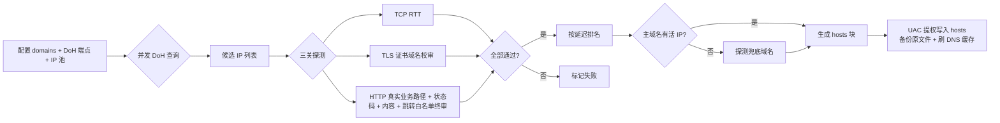

# ghprobe

你自己的网络，你自己测——GitHub 直连 hosts，本地自动探测、自动更新、无代理依赖。

## 这是什么

国内访问 GitHub 的故障不只在 DNS：主机名级 SNI 黑名单（如 raw 被精确 RST）、优质解析端点被整段封锁，且特征组合随地区/ISP/时刻漂移。中心化发布的静态 hosts 列表必然滞后。

ghprobe 把探测下放到你本地：

1. **DoH 联邦取候选**——全部走 DoH（无 UDP53 路径），默认国内实测可达端点，另合并内置 IP 池
2. **三关探测**——TCP RTT -> TLS 握手 + 证书域名校验 -> HTTP 应用层终审
3. **排名写 hosts**——每域名取最快可用 IP，提权写入系统 hosts（自动备份），git/浏览器即刻直连
4. **兜底链**——主域名候选全灭时自动探测替身域名（如 raw 走 jsdelivr）
5. **定时健康检查**——计划任务每 5 分钟测已写入 IP，异常才全量重排换 IP（不是无脑定时重跑）

不提供任何代理/隧道/流量转发/协议对抗；仅在运营商正常信道内优选可直连节点。

## 原理图



**三关探测细节：**

- **TCP RTT**：建立 443 端口连接，量基础网络延迟
- **TLS 证书域名校审**：证书 SAN 必须含目标域名，DNS 污染无法伪造有效证书
- **HTTP 应用层终审**：发送带 `Host: 域名` 的真实 GET，使用**真实业务路径**（如 `codeload.github.com` 直接请求归档下载路径，不是根路径），校验：
  - 状态码不在允许列表（5xx 直接判死）
  - 响应体含 `unknown domain` / `Fastly error` 等错误特征
  - 响应体缺失该域名必须包含的特征（如 `github.com` 需含 `github`）
  - 3xx 跳转目标不在该域名的白名单（如 `codeload.github.com` 坏节点会 302 回 `github.com` 主站，会被拦截）

  共享 CDN（如 Fastly）可能给 `github.com` 返回合法证书但错误页面；`codeload.github.com` 根路径可能 301 跳回主站但归档路径并不可用。这一关把这类"假活"IP 过滤掉。

## 快速开始

要求 Node.js >= 18（Windows 首发）。

### 一键部署（推荐，装完之后不用再碰命令行）

双击 `install.cmd`，或在 PowerShell 里执行：

```powershell
.\install.ps1
```

它会：自提权（**全程只弹一次 UAC**）→ 检查 Node 版本 → 安装依赖 → 注册计划任务 → 立即写入一次 hosts → **自检并把结果打回当前窗口**。装完即用；此后每 5 分钟自动健康检查，IP 陈旧时自动重排。

```powershell
.\install.ps1 -SkipProbe    # 只注册计划任务，等首轮健康检查自己写 hosts
.\install.ps1 -Uninstall    # 卸载：删除计划任务并还原 hosts
```

> 部署链路只依赖 Node.js 与仓库自身源码，不含任何闭源组件。
> 若你通过远程桌面/向日葵操作本机，注意 **UAC 弹窗走的是安全桌面，远程画面里可能看不到** —— 请在物理机前执行，或改用「以管理员身份运行」的终端。

### 手动命令

```bash
# 1. 跑一轮探测，看结果（不动系统）
node bin/ghprobe.js probe

# 2. 跑一轮并写入系统 hosts（弹 UAC，原 hosts 自动备份为 *.ghprobe-bak）
node bin/ghprobe.js probe --apply

# 3. 只生成 hosts 块文本，自己决定是否写入
node bin/ghprobe.js hosts

# 4. 注册计划任务：每 5 分钟健康检查，异常才全量换 IP（runlevel=highest，静默提权）
node bin/ghprobe.js install

# 5. 手动做一次健康检查（不写 hosts，异常只预览；加 --apply 才写）
node bin/ghprobe.js health

# 6. 删除计划任务并还原 hosts
node bin/ghprobe.js uninstall

# 7. 本地 API（默认 127.0.0.1:8930）
node bin/ghprobe.js serve
#   POST /api/probe   触发探测
#   GET  /api/status  最近结果
#   GET  /api/hosts   生成的 hosts 块
#   GET  /api/config  当前配置
```

> 仓库尚未发布到 npm，因此上面用 `node bin/ghprobe.js`；`package.json` 已声明 `bin`，发布后 `npx ghprobe` 等价。

## 配置

默认配置内置（`config.default.yaml`），可用 `-c my.yaml` 覆盖。对象属性（如 `timeouts`/`probe`/`serve`）会递归合并，你只需写想改的子键：

```yaml
# 只把 tls 超时改成 3s，dohMs/httpMs 保持默认
timeouts:
  tlsMs: 3000
```

完整配置示例：

```yaml
domains:
  - github.com
  - codeload.github.com
  - objects.githubusercontent.com
  - raw.githubusercontent.com
  - gist.githubusercontent.com
  - avatars.githubusercontent.com

# DoH 端点（IP 直连，sni 填服务域名用于证书校验）
doh:
  - { name: alidns1, host: 223.5.5.5, sni: dns.alidns.com, path: /dns-query }
  - { name: alidns2, host: 223.6.6.6, sni: dns.alidns.com, path: /dns-query }
  - { name: dnspod, host: 1.12.12.12, sni: doh.pub, path: /dns-query }

# 内置候选 IP 池：与域名无关地全量进候选，由 TLS 证书 + 应用层终审共同分流
ipPools:
  fastly: [185.199.108.133, 185.199.109.133, 185.199.110.133, 185.199.111.133]
  azure: [20.27.177.113, 4.208.26.197, 140.82.112.3]

# 兜底链：主域名全灭时改探测这些替身域名
fallbacks:
  raw.githubusercontent.com: [cdn.jsdelivr.net]

timeouts: { dohMs: 5000, tlsMs: 6000, httpMs: 6000 }
probe: { maxCandidates: 8, maxPerDomain: 4, concurrency: 6 }
serve: { host: 127.0.0.1, port: 8930 }
schedule:
  healthMin: 5            # 哨兵间隔（分钟）：只测已写入 IP，异常才触发全量
  absentCooldownHours: 1  # 缺失域名冷却（小时）：SNI 层封锁的域名全量也救不回，冷却内不重试
```

## 设计细节

- **为什么需要应用层终审**：TLS 证书能防 DNS 污染，但防不住共享 CDN 上未部署目标域名的"假活"IP。实测 Fastly 某些节点给 `github.com` 返回合法证书但 `Fastly error: unknown domain` 错误页，因此第三关必须校验 HTTP 状态码和响应特征
- **内置池为何不按域名分**：池子与域名无关地全量进候选，由证书 + 应用层终审自然分流。简单且不怕 GitHub 换 CDN
- **hosts 块有标记**：`# === ghprobe begin/end ===` 之间的内容归本工具管，重复 apply 只替换块内内容，用户自己的条目永不动
- **每域名只写一条**：Windows 对同一域名在 hosts 里只认第一条，因此 ghprobe 只把每个域名最优 IP 写进 hosts。排名里的"备选"只用于展示，不写入
- **写入是事务化的**：先备份原文件（首次 apply 才备份，后续不覆盖，避免污染快照）-> 覆盖 -> 校验块标记存在 -> 失败则回滚 -> 刷 DNS 缓存
- **uninstall 还原 hosts**：先还原 hosts，再删计划任务；优先用 `*.ghprobe-bak` 恢复，无备份则移除 ghprobe 块后写回；删任务失败不影响 hosts 回滚

### 调度架构

网络有波动，固定频率的"每隔 N 小时全量重跑"是错配：网络好时白测、坏时反应太慢。ghprobe 用**分层健康检查**替代：

- **哨兵层（每 5 分钟）**：一次 `ghprobe health` 只并发探测 hosts 块里**已写入的那批 IP**，一轮 <2 秒。全健康就静默退出，不动 hosts。
- **重炮层（异常才触发）**：只有确认已有 IP 失效，才跑完整全量探测（DoH 重解析 + 全候选三关）。

关键抗抖动与安全设计：

- **横向判据**：只有当**所有**已写入 IP 同时失败（且条目数 ≥ 2）时才判定为网络故障（黑洞窗口），本轮不动——不写空块、不误杀好 IP。只要还有**任意一条健康**，就说明链路是通的，失败的那些就是 IP 陈旧/真死，触发重排换 IP。
- **全灭护栏**：全量探测后若某域名仍无活 IP，保留旧条目不动，绝不会写成空块把好 IP 一起抹掉。网络几十秒自愈后原 IP 仍在。
- **部分更新 + IP 粘性**：全量重排后，只更新与当前 hosts 不同的域名；健康域名的 score 微小抖动不会触发换 IP（每次换 IP 代价是刷 DNS 缓存 + 连接池失效）。
- **缺失域名覆盖**：配置里有、hosts 里没有的域名（如 SNI 层封锁的 raw）也算"不健康"，会触发全量重试；但全量也救不回的域名会记入 `# absent` 冷却 1 小时，避免重炮每 5 分钟空响。
- **无状态文件**：缺失冷却表直接编码进 hosts 块注释，跨进程、跨重启不丢，无需额外状态文件。

`install` 注册的计划任务以 `runlevel=highest` 运行，apply 提权静默完成，不弹 UAC；手动跑 `health --apply` 时才会弹。

## 已知边界

- 工具只能找到**当前网络、当前时刻**可用的 IP；ISP/地区/时刻变了结果会变，因此需要定时重跑
- 如果所有候选 IP 都不可用，工具会命中兜底链或触发全灭护栏（保留旧 IP 不写空块），不会硬塞错误 IP
- Windows hosts 单域名多 IP 不轮询，所以 ghprobe 每个域名只写一条最优记录
- **单 IP 无故障转移**：每域名只写一条最优 IP，若该 IP 在两次健康检查之间失效，最坏中断时长 = `schedule.healthMin`（默认 5 分钟）。这是 hosts 机制本身的限制，不是能靠探测规避的
- **计划任务锁屏不运行**：`install` 注册的任务 `LogonType` 为 `Interactive`，锁屏/注销/未登录状态下不会触发，登录后按间隔继续

## 免责声明

本工具仅做 DNS 优选与连通性探测，不提供、不包含、不协助任何代理、隧道、流量转发或网络管控对抗能力。使用本工具产生的一切后果由使用者自行承担。请遵守你所在地区的法律法规。

## License

**ghprobe** 以 **GNU General Public License v3.0** 发布，授权范围 **GPL-3.0-or-later**（SPDX 标识符：`GPL-3.0-or-later`）——即被许可方可选择按 GPL v3 或任何后续版本使用。

```
ghprobe — GitHub 直连优选：本地 DoH 解析 + TLS 证书终审探测 + hosts 生成（无代理）
Copyright (C) 2026 zmw

This program is free software: you can redistribute it and/or modify
it under the terms of the GNU General Public License as published by
the Free Software Foundation, either version 3 of the License, or
(at your option) any later version.

This program is distributed in the hope that it will be useful,
but WITHOUT ANY WARRANTY; without even the implied warranty of
MERCHANTABILITY or FITNESS FOR A PARTICULAR PURPOSE.  See the
GNU General Public License for more details.

You should have received a copy of the GNU General Public License
along with this program.  If not, see <https://www.gnu.org/licenses/>.
```

你可以自由地运行、研究、修改和再分发本软件，但需满足 GPL-3.0 的以下条件：

- **开源传染（copyleft）**：分发本软件或其衍生作品时，必须一并提供完整对应源码，且衍生作品须以**相同协议**授权
- **保留声明**：不得移除版权声明、许可声明与免责声明
- **无担保**：作者不提供任何明示或默示担保（详见 GPL-3.0 第 15、16 条）

完整协议文本见仓库根目录的 [`LICENSE`](LICENSE)（顶部为版权声明，下方为 GPL-3.0 逐字正文）；每个源文件头部均带 `SPDX-License-Identifier: GPL-3.0-or-later` 声明。
