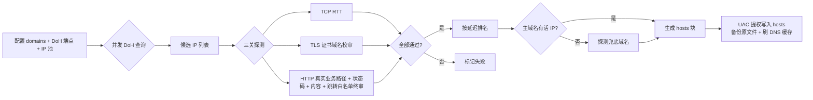

# ghprobe

你自己的网络，你自己测——GitHub 直连 hosts，本地自动探测、自动更新、无代理依赖。

## 这是什么

国内访问 GitHub 的故障不只在 DNS：主机名级 SNI 黑名单（如 raw 被精确 RST）、优质解析端点被整段封锁，且特征组合随地区/ISP/时刻漂移。中心化发布的静态 hosts 列表必然滞后。

ghprobe 把探测下放到你本地：

1. **DoH 联邦取候选**——全部走 DoH（无 UDP53 路径），默认国内实测可达端点，另合并内置 IP 池
2. **三关探测**——TCP RTT -> TLS 握手 + 证书域名校验 -> HTTP 应用层终审
3. **排名写 hosts**——每域名取最快可用 IP，提权写入系统 hosts（自动备份），git/浏览器即刻直连
4. **兜底链**——主域名候选全灭时自动探测替身域名（如 raw 走 jsdelivr）
5. **定时保活**——计划任务定期重跑，特征变了自动换

不提供任何代理/隧道/流量转发/协议对抗；仅在运营商正常信道内优选可直连节点。

## 原理图



**三关探测细节：**

- **TCP RTT**：建立 443 端口连接，量基础网络延迟
- **TLS 证书域名校审**：证书 SAN 必须含目标域名，DNS 污染无法伪造有效证书
- **HTTP 应用层终审**：发送带 `Host: 域名` 的真实 GET，使用**真实业务路径**（如 `codeload.github.com` 直接请求归档下载路径，不是根路径），校验：
  - 状态码不在允许列表（5xx 直接判死）
  - 响应体含 `unknown domain` / `Fastly error` 等错误特征
  - 响应体缺失该域名必须包含的特征（如 `github.com` 需含 `github`）
  - 3xx 跳转目标不在该域名的白名单（如 `codeload.github.com` 坏节点会 302 回 `github.com` 主站，会被拦截）

  共享 CDN（如 Fastly）可能给 `github.com` 返回合法证书但错误页面；`codeload.github.com` 根路径可能 301 跳回主站但归档路径并不可用。这一关把这类"假活"IP 过滤掉。

## 快速开始

要求 Node.js >= 18（Windows 首发）。

```bash
# 1. 跑一轮探测，看结果（不动系统）
npx ghprobe probe

# 2. 跑一轮并写入系统 hosts（弹 UAC，原 hosts 自动备份为 *.ghprobe-bak）
npx ghprobe probe --apply

# 3. 只生成 hosts 块文本，自己决定是否写入
npx ghprobe hosts

# 4. 注册计划任务：每 6 小时自动探测并写入
npx ghprobe install

# 5. 删除计划任务并还原 hosts
npx ghprobe uninstall

# 6. 本地 API（默认 127.0.0.1:8930）
npx ghprobe serve
#   POST /api/probe   触发探测
#   GET  /api/status  最近结果
#   GET  /api/hosts   生成的 hosts 块
#   GET  /api/config  当前配置
```

## 配置

默认配置内置（`config.default.yaml`），可用 `-c my.yaml` 覆盖。对象属性（如 `timeouts`/`probe`/`serve`）会递归合并，你只需写想改的子键：

```yaml
# 只把 tls 超时改成 3s，dohMs/httpMs 保持默认
timeouts:
  tlsMs: 3000
```

完整配置示例：

```yaml
domains:
  - github.com
  - codeload.github.com
  - objects.githubusercontent.com
  - raw.githubusercontent.com
  - gist.githubusercontent.com
  - avatars.githubusercontent.com

# DoH 端点（IP 直连，sni 填服务域名用于证书校验）
doh:
  - { name: alidns1, host: 223.5.5.5, sni: dns.alidns.com, path: /dns-query }
  - { name: alidns2, host: 223.6.6.6, sni: dns.alidns.com, path: /dns-query }
  - { name: dnspod, host: 1.12.12.12, sni: doh.pub, path: /dns-query }

# 内置候选 IP 池：与域名无关地全量进候选，由 TLS 证书 + 应用层终审共同分流
ipPools:
  fastly: [185.199.108.133, 185.199.109.133, 185.199.110.133, 185.199.111.133]
  azure: [20.27.177.113, 4.208.26.197, 140.82.112.3]

# 兜底链：主域名全灭时改探测这些替身域名
fallbacks:
  raw.githubusercontent.com: [cdn.jsdelivr.net]

timeouts: { dohMs: 5000, tlsMs: 6000, httpMs: 6000 }
probe: { maxCandidates: 8, maxPerDomain: 4, concurrency: 6 }
serve: { host: 127.0.0.1, port: 8930 }
schedule: { intervalHours: 6 }
```

## 设计细节

- **为什么需要应用层终审**：TLS 证书能防 DNS 污染，但防不住共享 CDN 上未部署目标域名的"假活"IP。实测 Fastly 某些节点给 `github.com` 返回合法证书但 `Fastly error: unknown domain` 错误页，因此第三关必须校验 HTTP 状态码和响应特征
- **内置池为何不按域名分**：池子与域名无关地全量进候选，由证书 + 应用层终审自然分流。简单且不怕 GitHub 换 CDN
- **hosts 块有标记**：`# === ghprobe begin/end ===` 之间的内容归本工具管，重复 apply 只替换块内内容，用户自己的条目永不动
- **每域名只写一条**：Windows 对同一域名在 hosts 里只认第一条，因此 ghprobe 只把每个域名最优 IP 写进 hosts。排名里的"备选"只用于展示，不写入
- **写入是事务化的**：先备份原文件（首次 apply 才备份，后续不覆盖，避免污染快照）-> 覆盖 -> 校验块标记存在 -> 失败则回滚 -> 刷 DNS 缓存
- **uninstall 还原 hosts**：先还原 hosts，再删计划任务；优先用 `*.ghprobe-bak` 恢复，无备份则移除 ghprobe 块后写回；删任务失败不影响 hosts 回滚

## 已知边界

- 工具只能找到**当前网络、当前时刻**可用的 IP；ISP/地区/时刻变了结果会变，因此需要定时重跑
- 如果所有候选 IP 都不可用，工具会写出空块（或命中兜底链），不会硬塞错误 IP
- Windows hosts 单域名多 IP 不轮询，所以 ghprobe 每个域名只写一条最优记录

## 免责声明

本工具仅做 DNS 优选与连通性探测，不提供、不包含、不协助任何代理、隧道、流量转发或网络管控对抗能力。使用本工具产生的一切后果由使用者自行承担。请遵守你所在地区的法律法规。

## License

本项目以 **GNU General Public License v3.0**（SPDX 标识符：`GPL-3.0`）发布。

```
Copyright (C) 2026 zmw

This program is free software: you can redistribute it and/or modify
it under the terms of the GNU General Public License as published by
the Free Software Foundation, version 3 of the License.

This program is distributed in the hope that it will be useful,
but WITHOUT ANY WARRANTY; without even the implied warranty of
MERCHANTABILITY or FITNESS FOR A PARTICULAR PURPOSE.  See the
GNU General Public License for more details.
```

你可以自由地运行、研究、修改和再分发本软件，但需满足 GPL-3.0 的以下条件：

- **开源传染（copyleft）**：分发本软件或其衍生作品时，必须一并提供完整对应源码，且衍生作品须以**相同协议**授权
- **保留声明**：不得移除版权声明、许可声明与免责声明
- **无担保**：作者不提供任何明示或默示担保（详见 GPL-3.0 第 15、16 条）

完整协议文本见仓库根目录的 [`LICENSE`](LICENSE)；每个源文件头部均带 `SPDX-License-Identifier: GPL-3.0` 声明。
